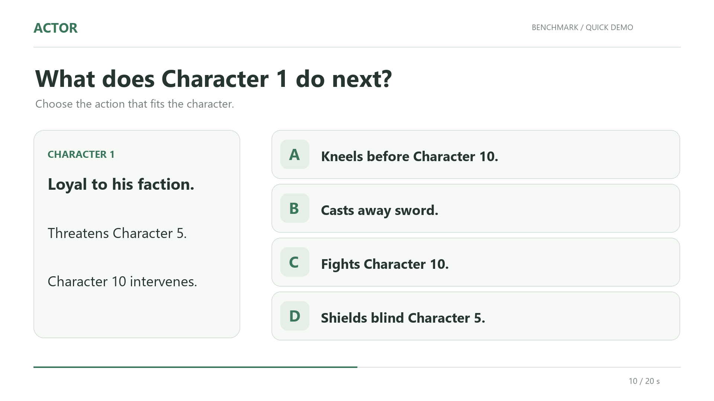
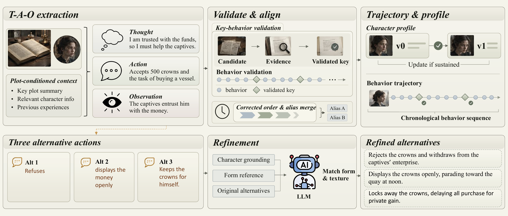

<h1 align="center">ACTOR</h1>

<p align="center">
  <strong>从小说中构建角色行为数据，评测与训练语言模型的角色行为预测能力</strong>
</p>

<p align="center">
  <a href="#数据构建">数据构建</a> ·
  <a href="#模型评测">模型评测</a> ·
  <a href="#rpo-训练">RPO 训练</a>
</p>

<p align="center">
  <a href="README.md">English</a> · <strong>简体中文</strong>
</p>

[](figures/benchmark_demo.mp4)

▶ [点击观看演示](figures/benchmark_demo.mp4)：以一道真实匿名题目展示角色上下文、候选行为及参考答案。上下文为便于展示而精简。

## 项目介绍

ACTOR 提供从小说原文到角色行为数据集的完整构建流水线，以及配套的模型评测和 RPO 训练工具。

给定角色档案、历史记忆和当前情境，模型需要从候选行为中选择符合该角色的行为。仓库包含三个部分：

- **数据构建**：提取角色行为轨迹，生成角色档案与反事实行为，构建训练和评测样本，并完成匿名化处理。
- **模型评测**：通过 OpenAI 兼容 API 调用本地部署模型或闭源模型，运行行为选择评测、上下文消融和结果评分。
- **RPO 训练**：将训练样本转换为偏好训练格式，使用 LoRA 或 QLoRA 进行 RPO 训练。

原始小说、API 凭据和模型权重需要自行准备。数据构建会调用模型 API，并可能产生费用；建议先使用少量书籍验证配置，再运行完整批次。

## 目录

- [数据构建方法概览](#数据构建方法概览)
- [环境配置](#环境配置)
- [数据构建](#数据构建)
- [模型评测](#模型评测)
- [RPO 训练](#rpo-训练)
- [仓库结构](#仓库结构)

## 数据构建方法概览

<p align="center">
  <a href="figures/pipeline.png">
    
  </a>
</p>

图中展示 T-A-O 提取、行为校验与对齐、角色轨迹与档案及反事实行为细化。随后执行数据划分、匿名化和名称变体补漏，生成最终数据集；**匿名化发生在样本构建之后**，原始未匿名样本也会保留。点击图片可查看原始尺寸。

## 环境配置

以下命令均在下载或克隆后的仓库根目录执行，使用 Linux/macOS 的 Bash 环境，建议使用 Python 3.10 或更新版本。数据构建与评测需要可用的模型 API；RPO 训练需要另行准备 Linux GPU 环境和基础模型。

```bash
python3 -m pip install -r requirements.txt
cp config.example.json config.json
```

编辑 `config.json`，填写数据构建使用的 API 凭据：

```json
{
  "api_key": "your-api-key",
  "base_url": "https://your-service-address/v1"
}
```

## 数据构建

### 输入与划分

准备小说源文件和三份书单：

| 文件                       | 用途与划分规则                                                   |
| -------------------------- | ---------------------------------------------------------------- |
| `data/src/all_books.jsonl` | 小说原文，每行一本书                                             |
| `eval_only_books.txt`      | 全部行为进入评测候选范围，经筛选和采样后生成题目                 |
| `train_eval_books.txt`     | 每个角色按行为时间顺序划分，前 80% 训练、后 20% 评测，再分别筛选 |
| `train_only_books.txt`     | 全部行为进入训练候选范围，经筛选后生成样本                       |

小说源文件格式：

```json
{ "title": "Book title", "author": "Author", "content": "Full novel text..." }
```

每本书占一个 JSONL 行；正文中的换行应编码为 JSON 字符串里的 `\n`，不要把单条记录写成多行 JSON，也不要插入空白行。

书单每行填写一个书名，必须与源文件中的 `title` 完全一致。三份书单必须两两不重叠，并共同覆盖源文件中的全部书籍，每本书恰好出现一次。某份书单可以为空，但仍需创建对应的空文件。

划分范围不等于最终样本数量。角色档案、行为数量和反事实生成质量等条件会影响可用样本数；并非每条提取行为都会生成题目或训练样本。

### 启动流水线

```bash
MODEL=your-model-name bash run_all.sh
```

将 `your-model-name` 替换为服务实际提供的模型名称；不设置 `MODEL` 时默认为 `gpt-5.6-luna`。

总控脚本先检查输入、API 配置与基础依赖，再顺序执行所有构建阶段。配置检查不验证 API 连通性、模型可用性或参数兼容性。

`run_all.sh` 默认采用保守配置：并行书籍数为 `1`，档案、重处理和单文件匿名化的 worker 数均为 `2`，同时匿名化文件数为 `1`，RPM 为 `60`，TPM 为 `200000`。

### 失败处理与续跑

部分书籍、人物或行为失败时，流水线记录问题并继续处理有效产物；重复运行会按各阶段的续跑规则复用已完成工作。存在阶段失败时，总控脚本在后续阶段执行完后返回非零退出码，请检查汇总和阶段日志。

续跑不保证所有输入均成功，也不保证修改配置后自动重建已有产物；重建前需确认对应阶段的缓存与输出处理方式。

### 输出位置

```text
data/
├── dataset/
│   ├── eval/              # 匿名化前的评测题
│   └── train/             # 匿名化前的训练样本
├── dataset_anon/          # LLM 匿名化后的中间产物
├── dataset_final/
│   ├── eval/              # 最终匿名评测题，按书存储
│   └── train/             # 最终匿名训练样本，按书存储
└── logs/full_pipeline/
    └── summary.json       # 各阶段运行汇总
```

<details>
<summary><strong>进阶：并发、限流与自定义启动参数</strong></summary>

`run_all.sh` 使用固定的保守并发和限流配置。除 `MODEL` 外，这些设置不能通过环境变量覆盖；需要调整时，直接调用 Python 总控脚本：

```bash
python3 run_full_pipeline.py \
  --eval-only-books eval_only_books.txt \
  --train-eval-books train_eval_books.txt \
  --train-only-books train_only_books.txt \
  --model your-model-name \
  --parallel-books 2 --max-rpm 120 --max-tpm 400000
```

下表默认值适用于**直接运行 `run_full_pipeline.py`**，与 Bash 快速启动入口的保守配置不同：

| 参数                         |         默认值 | 说明                                                   |
| ---------------------------- | -------------: | ------------------------------------------------------ |
| `--model`                    | `gpt-5.6-luna` | 轨迹提取、判断、档案生成、重处理与匿名化使用的模型     |
| `--parallel-books`           |            `8` | 轨迹提取、档案生成和重处理阶段的并行书籍数             |
| `--profile-workers`          |            `5` | 每本书生成档案的并发数                                 |
| `--rewash-workers`           |            `8` | 每本书行为重处理的并发数                               |
| `--anonymize-workers`        |            `8` | 单文件匿名化的并发数                                   |
| `--parallel-anonymize-files` |            `1` | 同时匿名化的文件数，与单文件 worker 数共同影响请求并发 |
| `--max-rpm`                  |         `2000` | 传给调用模型的批处理阶段的每分钟请求限制               |
| `--max-tpm`                  |      `4000000` | 传给调用模型的批处理阶段的每分钟 token 限制            |

请按实际 API 配额调整并发和限流。

</details>

## 模型评测

### 题目示意

<p align="center">
  <a href="figures/benchmark_example.png">
    
  </a>
</p>

**任务示意图，非某条完整题目的复现。** 图片仅辅助展示，实际输入为文本，模型回答 A/B/C/D。图中合并展示的 Current Scene 与 Recent Memory，在数据中分别保存为 `scene` 和 `recent_memory`。

<details>
<summary><strong>评测 JSONL 字段一览</strong></summary>

| 字段                                    | 内容                                                  |
| --------------------------------------- | ----------------------------------------------------- |
| `profile`                               | 当前档案，提示词使用其中的 `text`                     |
| `long_term_memory` / `recent_memory`    | 关键历史与近期经历，包含 Thought、Action、Observation |
| `scene`                                 | 场景描述、时间及参与者信息                            |
| `options`                               | 四个候选行为，包含 `id` 和 `text`                     |
| `correct_answer`                        | 参考答案，仅用于评分，不输入模型                      |
| `question_id` / `split` / `is_critical` | 题目标识、评测分区及行为类型                          |

每行一个 JSON 对象。标准匿名评测不展示原书名或原人物姓名。

</details>

### 启动评测

配置 OpenAI 兼容服务并运行（本地 vLLM 示例）：

```bash
export OPENAI_BASE_URL="http://127.0.0.1:8000/v1"
export OPENAI_API_KEY="EMPTY"
bash eval/run_all.sh actual-served-model-name
```

模型服务必须提前启动；本仓库不会下载权重或启动服务。使用远程或闭源 API 时，请替换地址、密钥和模型名称，`EMPTY` 仅适用于接受该值的本地服务。

环境变量优先于根目录 `config.json`；未配置地址时使用默认 OpenAI 地址。

默认行为：

- 合并 `data/dataset_final/eval/*.jsonl` 到 `data/eval_questions_all.jsonl`。
- 使用 `no_book` 协议和完整上下文 `baseline`。
- 使用输出预算 `4`、`temperature=0`、`seed=0`，并发请求数为 `4`。
- 不启用选项约束，也不主动改变模型的 thinking 行为。
- 自动续跑，生成整体评分；在适用时生成分区评分。

> 默认 4-token 输出预算用于我们的本地选择题实验。某些模型服务，特别是需要推理预算的服务，可能需要更大的值，请显式配置 `EVAL_MAX_TOKENS`。

默认结果路径：

```text
data/eval_results/
├── results.jsonl
├── results.score.json
└── results.partition-score.json   # 有可用分区信息时生成
```

不同实验通过 `EVAL_OUTPUT` 指定独立的结果路径。只有题目文件、提示词、模型、服务地址和协议配置一致时才能续跑，脚本会检查保存的协议清单。

<details>
<summary><strong>进阶：评测参数与直接调用 Python</strong></summary>

| 环境变量                | Python 参数               | 默认值 / 用途                                                 |
| ----------------------- | ------------------------- | ------------------------------------------------------------- |
| `EVAL_QUESTIONS`        | `--questions`             | 默认自动合并最终匿名评测题；也可指定已有 JSONL                |
| `EVAL_OUTPUT`           | `--output`                | `data/eval_results/results.jsonl`                             |
| `EVAL_SCORES`           | `--scores`                | 默认 `<结果路径去扩展名>.score.json`                          |
| `EVAL_PARTITION_SCORES` | `--partition-scores`      | 默认 `<结果路径去扩展名>.partition-score.json`                |
| `EVAL_WORKERS`          | `--workers`               | `4`，并发请求数                                               |
| `EVAL_MAX_TOKENS`       | `--max-tokens`            | `4`，通过 `max_completion_tokens` 发送                        |
| `EVAL_TEMPERATURE`      | `--temperature`           | `0`；`omit` 对应 `--omit-temperature`                         |
| `EVAL_SEED`             | `--seed`                  | `0`；`omit` 对应 `--omit-seed`                                |
| `EVAL_ABLATION`         | `--ablation`              | `no_book`；标准协议名称为 `no_book/full`                      |
| `EVAL_CONTEXT_VARIANT`  | `--context-variant`       | `baseline`                                                    |
| `EVAL_GUIDED_CHOICE`    | `--guided-choice A B C D` | `off`；`on` 启用选项约束                                      |
| `EVAL_DISABLE_THINKING` | `--disable-thinking`      | `off`；`on` 发送 `chat_template_kwargs.enable_thinking=false` |
| `EVAL_PARTITION_MODE`   | `--partition-mode`        | `auto`；另支持 `required/off`                                 |
| `PYTHON`                | —                         | `python3`，评测 Bash 脚本使用的解释器                         |

也可以直接运行 Python，完成评测和评分：

```bash
python3 eval/run_eval.py \
  --questions /path/to/questions.jsonl \
  --output data/eval_results/my-run.jsonl \
  --base-url http://127.0.0.1:8000/v1 \
  --model served-model \
  --ablation no_book \
  --context-variant baseline \
  --max-tokens 4 \
  --temperature 0 \
  --seed 0 \
  --resume
```

直接调用 `run_eval.py` 不会自动读取根目录 `config.json`，请使用命令行参数或环境变量配置服务。

选项约束和关闭 thinking 属于服务扩展，并非所有服务或 vLLM 版本都支持。不支持的参数会产生明确错误，脚本不会自动删除参数后重试。显式省略 temperature、seed 或改变其他配置，也意味着改变了评测协议。

</details>

### 上下文消融

| `--context-variant` | 角色档案 | 长期记忆 | 近期记忆 |
| ------------------- | -------- | -------- | -------- |
| `baseline`          | 保留     | 保留     | 保留     |
| `no_profile`        | 移除     | 保留     | 保留     |
| `no_recent`         | 保留     | 保留     | 移除     |
| `no_long`           | 保留     | 移除     | 保留     |
| `no_memory`         | 保留     | 移除     | 移除     |

通过 `EVAL_CONTEXT_VARIANT` 选择配置，例如设为 `no_recent` 可移除近期记忆；同时设置新的 `EVAL_OUTPUT`。

<details>
<summary><strong>匿名与非匿名对比</strong></summary>

`no_book` 使用匿名题目，标准 `full` 设置使用对应的非匿名题目。仅切换 `EVAL_ABLATION` 不会恢复人名；运行 `full` 时，还需通过 `EVAL_QUESTIONS` 指定对应的非匿名题目文件：

```bash
EVAL_QUESTIONS=/path/to/matched-non-anonymous-questions.jsonl \
EVAL_ABLATION=full \
EVAL_OUTPUT=data/eval_results/my-model-full.jsonl \
  bash eval/run_all.sh served-model
```

匿名与非匿名对比实验应按题目 ID 对齐样本，不要直接假定两个阶段的文件包含完全相同的题目集合。

</details>

### 查看评分

```bash
python3 -m json.tool data/eval_results/results.score.json
```

<details>
<summary><strong>对已有结果重新评分</strong></summary>

```bash
python3 eval/score_eval.py \
  --questions /path/to/matching-questions.jsonl \
  --results /path/to/results.jsonl \
  --output /path/to/results.score.json \
  --summary

python3 eval/score_eval_partitions.py \
  --questions /path/to/matching-questions.jsonl \
  --results /path/to/results.jsonl \
  --output /path/to/results.partition-score.json
```

题目文件必须与结果文件对应。重新评分使用已有结果，不会再次调用模型 API。

</details>

## RPO 训练

### 训练样本示例

同一角色上下文对应一对 **chosen / rejected 行为文本**。下面是一条真实训练样本的节选：

| 上下文摘要 | Character 1 是修道院院长，早餐后拜访 Character 2，对方亲切地与她交谈                                  |
| ---------- | ----------------------------------------------------------------------------------------------------- |
| chosen     | Listens and smiles without saying a word while Character 2 talks of Court intrigues.                  |
| rejected   | Hastens to unseal the register, exposing each sheltered pensioner to Character 2 imprudent curiosity. |

### 环境准备

准备基础模型，以及 Linux、支持 BF16 和 FlashAttention 2 的 NVIDIA GPU 与兼容的 CUDA 版 PyTorch，然后安装训练依赖：

```bash
python3 -m pip install -r train/requirements.txt
python3 -m pip install flash-attn --no-build-isolation
```

FlashAttention 2 须与 GPU、PyTorch 和 CUDA 兼容；数据构建及 API 评测无需这些训练依赖。

### 准备训练数据

将最终训练数据转换为基础模型所需的训练格式：

```bash
bash train/run_prepare.sh \
  /path/to/base-model \
  data/train_prepared/my-model
```

默认读取 `data/dataset_final/train/`。如需使用其他输入目录，可通过第三个位置参数指定。

准备成功后生成 `train.jsonl`、`validation.jsonl`、`manifest.json` 和 `overlength.jsonl`。默认按 `sample_id` 的确定性哈希划出约 1% 作为训练验证集，区别于正式评测集；小规模数据可能没有验证样本。

默认总长度上限为 `8192` tokens，提示词上限为 `7168`。超长时写入审计文件和失败状态的 manifest 后停止，不生成或替换训练与验证文件，也不静默截断。检查 `overlength.jsonl` 后，如决定丢弃超长样本：

```bash
OVERLENGTH_POLICY=drop bash train/run_prepare.sh \
  /path/to/base-model \
  data/train_prepared/my-model
```

不同基础模型应使用独立的数据准备目录，因为长度检查依赖对应模型的 tokenizer。

### 启动训练

```bash
bash train/run_train.sh \
  /path/to/base-model \
  data/train_prepared/my-model \
  data/train_runs/my-model-rpo
```

三个位置参数依次为：**基础模型目录、准备好的数据目录、训练输出目录**。

默认单 GPU、4-bit QLoRA、`beta=0.1`、`rpo_alpha=1.0`，训练 1 个 epoch。RPO 使用 TRL `DPOTrainer`，额外加入由 `rpo_alpha` 加权的 chosen 回答 NLL 项。输出包含 checkpoint 和 `final_adapter/`；后者是 **LoRA 适配器而非完整权重**，使用时仍需基础模型。

### 训练前后的改善效果

以下是 Qwen2.5-7B-Instruct 与 ACTOR-Qwen-2.5-7B 在相同匿名题目上的真实预测。行为描述为选项摘要；模型实际输出字母。

| 案例                          | 基础模型              | RPO 训练后              | 参考答案 |
| ----------------------------- | --------------------- | ----------------------- | -------- |
| 管家遭遇阻挡（《李尔王》）    | D：保护失明者 ✗       | C：与阻挡者战斗 ✓       | C        |
| 家庭中的疏远关系（《简·爱》） | C：主动寻找对方作伴 ✗ | B：尽量减少与对方交谈 ✓ | B        |

<details>
<summary><strong>案例追溯</strong></summary>

评测题 ID：`King Lear::oswald::p029_s000_t002_a004`、`Jane Eyre::eliza_reed::p007_s000_t000_a000`。训练样本 ID：`The Three Musketeers::abbess::p129_s003_t001_a001`。

来源为 20260916 正式评测产物及 20260828 重建训练数据，预测已按 ID 核对。历史实验使用正式评测集的子集选择 checkpoint，并非完全独立的模型选择协议；此处只展示个例，不报告总体性能。

</details>

<details>
<summary><strong>进阶：训练参数与恢复训练</strong></summary>

| 环境变量                      |                         默认值 | 说明                                           |
| ----------------------------- | -----------------------------: | ---------------------------------------------- |
| `TRAIN_GPUS`                  |                            `1` | 单机 GPU 数；大于 1 时通过 `torchrun` 启动 DDP |
| `MODEL_PRECISION`             |                         `4bit` | `4bit` 为 QLoRA，`bf16` 为 LoRA                |
| `RPO_ALPHA`                   |                          `1.0` | chosen 回答 NLL 项权重；本配置要求大于 0       |
| `BETA`                        |                          `0.1` | 偏好损失参数                                   |
| `LEARNING_RATE`               |                         `5e-6` | 学习率                                         |
| `NUM_TRAIN_EPOCHS`            |                            `1` | 训练轮数                                       |
| `MAX_STEPS`                   |                           `-1` | 最大优化步数；`-1` 按 epoch 设置训练           |
| `BATCH_SIZE`                  |                            `1` | 每张 GPU 的批大小                              |
| `GRADIENT_ACCUMULATION_STEPS` |                            `8` | 梯度累积步数                                   |
| `RESUME`                      |                         `none` | `auto` 从最新 checkpoint 恢复，也可指定路径    |
| `BNB_RESUME_FIX`              |                            `0` | 仅在遇到相关优化器状态恢复问题时设为 `1`       |
| `MAX_LENGTH`                  |                         `8192` | 数据准备和训练须保持一致                       |
| `MAX_PROMPT_LENGTH`           |                         `7168` | 数据准备和训练须保持一致                       |
| `RUN_NAME`                    | `character-action-rpo-no-book` | 训练运行名称                                   |

数据准备还支持 `VALIDATION_RATIO`，默认值为 `0.01`。

例如，使用两张 GPU 和 BF16：

```bash
TRAIN_GPUS=2 MODEL_PRECISION=bf16 \
  bash train/run_train.sh \
  /path/to/base-model \
  data/train_prepared/my-model \
  data/train_runs/my-model-rpo-bf16
```

从同一输出目录的最新 checkpoint 恢复：

```bash
RESUME=auto bash train/run_train.sh \
  /path/to/base-model \
  data/train_prepared/my-model \
  data/train_runs/my-model-rpo
```

不启用恢复时，输出目录必须为空。仅在出现 bitsandbytes paged optimizer 状态恢复问题时启用 `BNB_RESUME_FIX=1`。

</details>

## 仓库结构

```text
ACTOR/
├── actor/                       # 数据构建模块
│   ├── trajectory_extraction/   # 轨迹提取、校验与对齐
│   ├── character_profiles/      # 角色档案生成
│   ├── action_refinement/       # 行为重处理与反事实细化
│   ├── dataset_building/        # 训练与评测样本构建
│   ├── name_anonymization/      # 匿名化与名称变体补漏
│   └── shared/                  # 公共工具与 API 调用组件
├── eval/                        # 评测、提示词构造与评分
├── train/                       # 训练数据准备与 RPO 训练
├── figures/                     # README 展示图片
├── config.example.json          # API 配置模板
├── requirements.txt             # 基础依赖
├── run_all.sh                   # 使用保守配置启动数据构建
└── run_full_pipeline.py         # 可自定义参数的数据构建入口
```
